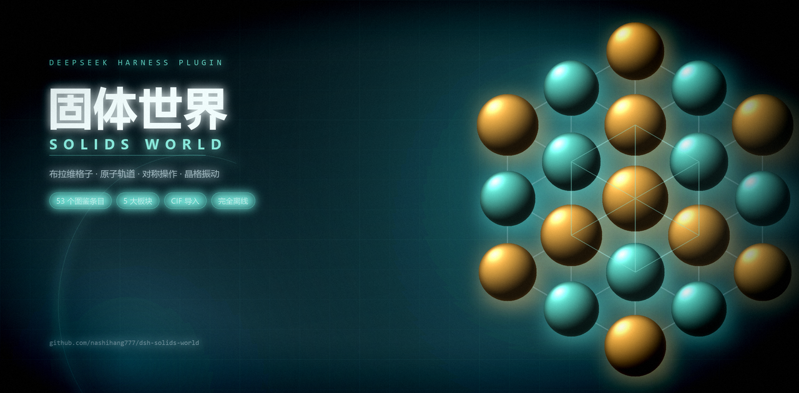

# Solids world · a DeepSeek Harness plugin (`@nashihang777/dsh-solids-world`)

[](https://github.com/topics/dsh-plugin)
[](https://github.com/nashihang777/dsh-solids-world/blob/main/package.json)
[](https://www.npmjs.com/package/@nashihang777/dsh-solids-world)
[](https://github.com/nashihang777/dsh-solids-world/blob/main/LICENSE)

[简体中文](README.md) · **English** · [GitHub](https://github.com/nashihang777/dsh-solids-world) · [npm](https://www.npmjs.com/package/@nashihang777/dsh-solids-world)



> **A DeepSeek Harness plugin** that brings a 3D atlas of solid-state and atomic physics into the
> Harness Web UI — crystal structures, Bravais lattices, atomic orbitals, symmetry operations and
> lattice dynamics, with stepped lessons and a quiz at the end.

This plugin re-hosts the renderer of the desktop app
[solids-world](https://github.com/nashihang777/solids-world) inside the Harness page. It takes two
existing seats, which makes it a first-class page rather than a widget: one crystal icon in the
sidebar, and the whole main panel for the atlas.

## What it does

- **53 bilingual entries** in five sections: crystal structures (12), Bravais lattices (14), atoms and orbitals (11), symmetry (11), lattice dynamics (5).
- **Programmatic 3D**: every model is computed from the physics at run time — spheres, bonds, cell frames, isosurfaces and animations. No model files, no network access.
- **Stepped lessons** whose camera focus and hotspot highlights follow each step; passing each entry's **quiz** is recorded together with its lesson progress.
- **Notes** per entry, an aggregate view, and one-click **Markdown export** (downloads a `.md` file).
- **Gallery** of all entries with their lesson / quiz status.
- **Search** over Chinese, English, aliases and pinyin; `/` focuses the box.
- **3D controls**: 1×/2× supercell, bonds, atom labels, clipping planes, spin, reset / focus / zoom; orbital entries add isosurface threshold, phase mode, opacity, nodal surfaces and radial range; symmetry and dynamics entries add play, pause, speed, single-step and parameter sliders.
- **CIF import**: drop a `.cif` file onto the panel, or use **Open CIF** in the top bar. Lexing, parsing, space-group expansion and structure extraction all run locally; syntax errors, unknown space groups and oversized files are reported explicitly.
- **Bilingual and themed**: one-click zh/en switch, light and dark themes, and respect for the system "reduce motion" preference.
- **Keyboard**: arrow keys step entries, `/` focuses search, `F` focuses the stage, `Ctrl/⌘+D` opens a random entry, `Esc` closes the topmost layer.

## Install

From the workspace that contains this directory, either:

**From npm** (available once published):

```
plugin_manager action=install_bundle target=@nashihang777/dsh-solids-world
```

**From a local directory** (the directory is linked, so source edits need no reinstall):

```
plugin_manager action=install_bundle target=<absolute path to this directory>
```

Then open **Solids world** from the sidebar panel column; its icon sits after the built-in panel icons.

Settings and notes live in the page's `localStorage`, so they survive a restart and stay
independent of the rest of the profile's data.

## Build

`client.js` is generated. Rebuild after changing anything under `src/`:

```bash
node scripts/build.mjs
```

The build needs esbuild, postcss and `three`. It looks for them in `node_modules/` here first, then
in the directory named by `SOLIDS_WORLD_SRC`, then in the sibling `../solids-world`. So either
`npm install` here, or clone the
[upstream desktop app](https://github.com/nashihang777/solids-world) and point `SOLIDS_WORLD_SRC` at
it. **Running the plugin needs neither**: `client.js` is standalone.

`tsconfig.json` is for editors and type checking only. The build pins its own compiler options
(`tsconfigRaw`), so it cannot drift with that file — notably it keeps
`useDefineForClassFields: false`, the semantics the upstream Vite build used.

The build script does four things:

1. generates `src/atlas/three/builders-map.ts` — the desktop app enumerated its 53 builders with Vite's `import.meta.glob`, which esbuild does not support;
2. scopes the desktop stylesheet into `.sw-atlas` with PostCSS, so the atlas cannot restyle the host page;
3. bundles `src/client/index.tsx` as an IIFE with three.js inlined and `react` resolved to the host's instance;
4. wraps the bundle in the `window.__ModuleLoader__.load` factory contract.

## Verify

Two headless checks ship with the sources; both reuse the `solids-world` checkout's `node_modules`,
so no extra install is needed:

```bash
node scripts/smoke.mjs          # loads client.js the way the module loader does
node scripts/check-content.mjs  # atlas data, 53 models, CIF samples
```

`smoke.mjs` runs the built bundle inside jsdom with a stand-in module loader and host context,
mounts the panel and asserts: the scoped panel root, the inherited theme and locale, all 53 library
rows, entry selection, the help modal, the CIF input, settings and notes persistence, language
switching, and cleanup on unload. jsdom has no WebGL, so the 3D stage degrades to its fallback
notice there.

`check-content.mjs` asserts: both locales expose the same entries with lessons and quizzes, every
entry owns exactly one 3D builder, all 53 models construct in 1× and 2× supercells, a parsed CIF
becomes a model, and the bundled CIF samples still produce their recorded atoms, elements and error
codes.

Type checking uses the same checkout:

```bash
New-Item -ItemType Junction -Path node_modules -Target ../solids-world/node_modules
node node_modules/typescript/bin/tsc -p tsconfig.json --noEmit
```

After rebuilding `client.js`, refresh the page (or restart Harness) to load the new Client module
generation.

## Layout

```
index.js               Host half (the atlas needs no Host service)
client.js              build output: the Client half
cordis.patch.yml       bundle row
locale/{en,zh}.json    display title and description
assets/social-preview.png  social preview image
src/client/index.tsx   slot registration, theme and locale inheritance, icon
src/client/bridge.ts   page-side replacement for the Electron preload
src/atlas/**           the ported desktop renderer
src/electron/**        CIF parser plus the settings and notes models
```

Two porting differences are worth remembering when editing `src/atlas`: `three/Stage.tsx` is
rewritten against plain three.js (the host page supplies no react-three-fiber), and `App.tsx`
scopes drag-and-drop and keyboard handling to the panel instead of the whole page.

## Differences from the desktop app

- **No post-processing**: the N8AO ambient-occlusion and bloom passes depend on react-three-fiber's composer and are gone; `postfx` now only selects the render resolution tier. Lighting, geometry, materials and colors are otherwise unchanged.
- **No native window shell**: the Electron menu becomes the top bar's **Open CIF**, **?** and **⌘** buttons; the notes export downloads a file instead of opening a save dialog.
- **Keyboard scope**: shortcuts act only inside the panel, so they never steal keys from the Harness shell.
- **Breakpoints**: the original stylesheet breaks on viewport width; in a narrow panel on a wide screen the three-column layout keeps its desktop proportions.

## Releasing

See [RELEASING.md](RELEASING.md): pushing a `v*` tag runs GitHub Actions, which publishes to npm
through GitHub OIDC trusted publishing — no long-lived token, with provenance attached. Changes are
recorded in [CHANGELOG.md](CHANGELOG.md).

## Attribution and license

MIT. The renderer, entry data, lessons, quizzes and CIF parser come from **solids-world**
(© 2026 世界航海, MIT) — see [NOTICE](NOTICE) and [LICENSE](LICENSE). The plugin scaffolding (bundle
manifest, client entry, page bridge, build script, icon and social preview) is original to this
package.
