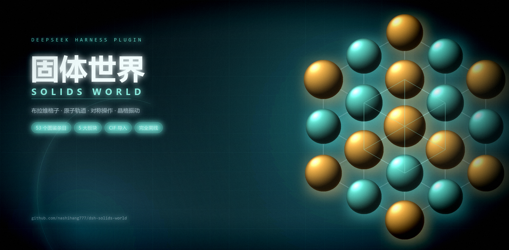

# 固体世界 · DeepSeek Harness 插件（`@nashihang777/dsh-solids-world`）

[](https://github.com/topics/dsh-plugin)
[](https://github.com/nashihang777/dsh-solids-world/blob/main/package.json)
[](https://www.npmjs.com/package/@nashihang777/dsh-solids-world)
[](https://github.com/nashihang777/dsh-solids-world/blob/main/LICENSE)

**简体中文** · [English](README.en.md) · [GitHub](https://github.com/nashihang777/dsh-solids-world) · [npm](https://www.npmjs.com/package/@nashihang777/dsh-solids-world)



> **DeepSeek Harness 插件**：把固体物理与原子物理的 3D 图鉴搬进 Harness Web 界面——晶体结构、布拉维格子、原子轨道、对称操作与晶格动力学，边转边讲、讲完即测。
> An interactive 3D atlas of solid-state and atomic physics for DeepSeek Harness.

本插件把桌面应用 [solids-world](https://github.com/nashihang777/solids-world) 的渲染层重新托管到 Harness 页面中。它占用两个现成插槽，因此表现为 Harness 的一等页面，而不是一个挂件：侧栏多一个晶体图标，主面板整页展示图鉴。

## 功能介绍

- **53 个中英双语条目**，分五个板块：晶体结构（12）、布拉维格子（14）、原子与轨道（11）、对称性（11）、晶格动力学（5）。
- **程序化 3D**：所有模型按物理公式实时生成——球体、化学键、晶胞线框、等值面与动画，零外部模型文件，零联网。
- **分步讲解**：每一步都联动镜头对焦与标注点高亮；每条的**小测验**通过后与讲解进度一并记入该条目。
- **学习笔记**：逐条记笔记、汇总浏览、一键导出 Markdown（下载 `.md` 文件）。
- **图鉴画廊**：总览全部条目及其讲解 / 测验状态。
- **搜索**：中文、英文、别名与拼音检索，按 `/` 直接聚焦搜索框。
- **3D 操控**：1×/2× 超胞、成键开关、原子标签、剖切平面、自旋、复位 / 对焦 / 缩放；轨道条目另有等值面阈值、相位模式、不透明度、波节面与径向范围；对称与动力学条目另有播放、暂停、调速、单步与参数滑块。
- **CIF 导入**：把 `.cif` 拖到面板上，或用顶栏的「打开 CIF」。词法、语法、空间群展开与结构提取全部本地完成；语法错误、未知空间群、超出体积上限都会明确提示。
- **双语与主题**：中英一键切换，明暗双主题，并遵循系统「减少动态效果」设置。
- **键盘**：方向键切换条目、`/` 聚焦搜索、`F` 聚焦舞台、`Ctrl/⌘+D` 随机一条、`Esc` 关闭最上层。

## 安装

在包含本目录的工作区里，任选一种：

**从 npm 安装**（发布后可用）：

```
plugin_manager action=install_bundle target=@nashihang777/dsh-solids-world
```

**从本地目录安装**（目录会以链接方式装入，改动源码后无需重装）：

```
plugin_manager action=install_bundle target=<本目录的绝对路径>
```

安装后从侧栏面板区打开「固体世界」，图标位于内置面板图标之后。

设置与笔记存放在页面的 `localStorage` 中，重启后保留，且与本 profile 的其它数据相互独立。

## 构建

`client.js` 是产物，改动 `src/` 后需要重新生成：

```bash
node scripts/build.mjs
```

构建需要 esbuild、postcss 与 `three`。查找顺序：本目录的 `node_modules/` → `SOLIDS_WORLD_SRC` 指向的目录 → 同级 `../solids-world`。因此要么在本目录 `npm install`，要么克隆[上游桌面应用](https://github.com/nashihang777/solids-world)并把 `SOLIDS_WORLD_SRC` 指向它。**运行插件两者都不需要**：`client.js` 自包含。

`tsconfig.json` 仅供编辑器与类型检查使用。构建用 `tsconfigRaw` 固定自己的编译选项，因此不会随该文件漂移——尤其是保持 `useDefineForClassFields: false`，与上游 Vite 构建的语义一致。

构建脚本依次做四件事：

1. 生成 `src/atlas/three/builders-map.ts`——桌面应用用 Vite 的 `import.meta.glob` 枚举 53 个 builder，esbuild 不支持该语法；
2. 用 PostCSS 把桌面样式表作用域收进 `.sw-atlas`，使其不会改动宿主界面；
3. 把 `src/client/index.tsx` 打包成 IIFE，three.js 内联，`react` 解析到宿主实例；
4. 按 `window.__ModuleLoader__.load` 的工厂约定包装产物。

## 验证

仓库自带两个无头检查，均复用 `solids-world` 检出的 `node_modules`，无需额外安装：

```bash
node scripts/smoke.mjs          # 按模块加载器约定加载 client.js
node scripts/check-content.mjs  # 图鉴数据、53 个模型、CIF 样例
```

`smoke.mjs` 在 jsdom 中以替身模块加载器与宿主上下文运行构建产物，挂载面板并断言：作用域面板根、继承的明暗与语言、53 行目录、条目切换、帮助弹层、CIF 输入、设置与笔记持久化、中英切换、卸载清理。jsdom 没有 WebGL，3D 舞台在那里退化为提示文案。

`check-content.mjs` 断言：两种语言的条目一一对应且都带讲解与测验、每个条目恰有一个 3D builder、53 个模型在 1× 与 2× 下都能构建、解析出的 CIF 能变成模型、内置 CIF 样例仍产出记录的原子数、元素与错误码。

类型检查同样借用该检出：

```bash
New-Item -ItemType Junction -Path node_modules -Target ../solids-world/node_modules
node node_modules/typescript/bin/tsc -p tsconfig.json --noEmit
```

重新生成 `client.js` 后需要刷新页面（或重启 Harness）以加载新的客户端模块代。

## 目录结构

```
index.js               宿主半侧（图鉴不需要宿主服务）
client.js              构建产物：客户端半侧
cordis.patch.yml       bundle 注册行
locale/{en,zh}.json    显示用标题与描述
assets/social-preview.png  社交预览图
src/client/index.tsx   插槽注册、主题与语言继承、图标
src/client/bridge.ts   替代 Electron preload 的页面桥接
src/atlas/**           移植的桌面渲染层
src/electron/**        CIF 解析器与设置 / 笔记模型
```

改 `src/atlas` 时有两处移植差异需要记住：`three/Stage.tsx` 是纯 three.js 重写（宿主页面不提供 react-three-fiber）；`App.tsx` 把拖放与键盘处理收敛到面板内，而不是整页。

## 与桌面版的差异

- **无后处理**：N8AO 环境光遮蔽与 bloom 依赖 react-three-fiber 的 composer，已移除；`postfx` 现在只决定渲染分辨率档位。光照、几何、材质与配色其余不变。
- **无原生窗口外壳**：Electron 菜单变为顶栏的「打开 CIF」「?」「⌘」按钮；笔记导出改为下载文件而非弹出保存对话框。
- **键盘作用域**：快捷键只作用于面板，不会抢走 Harness 外壳的按键。
- **断点**：原样式表按视口宽度断点；在宽屏上的窄面板里，三栏布局保持桌面比例。

## 发布

发布流程见 [RELEASING.md](RELEASING.md)：推送 `v*` 标签触发 GitHub Actions，以 GitHub OIDC 可信发布（Trusted Publishing）发到 npm，不保存任何长期令牌，并自动附带 provenance。变更记录见 [CHANGELOG.md](CHANGELOG.md)。

## 归属与许可

MIT。渲染层、条目数据、讲解与测验、CIF 解析器来自 **solids-world**（© 2026 世界航海，MIT）——见 [NOTICE](NOTICE) 与 [LICENSE](LICENSE)。插件脚手架（bundle 清单、客户端入口、页面桥接、构建脚本、图标与社交预览图）为本包原创。
